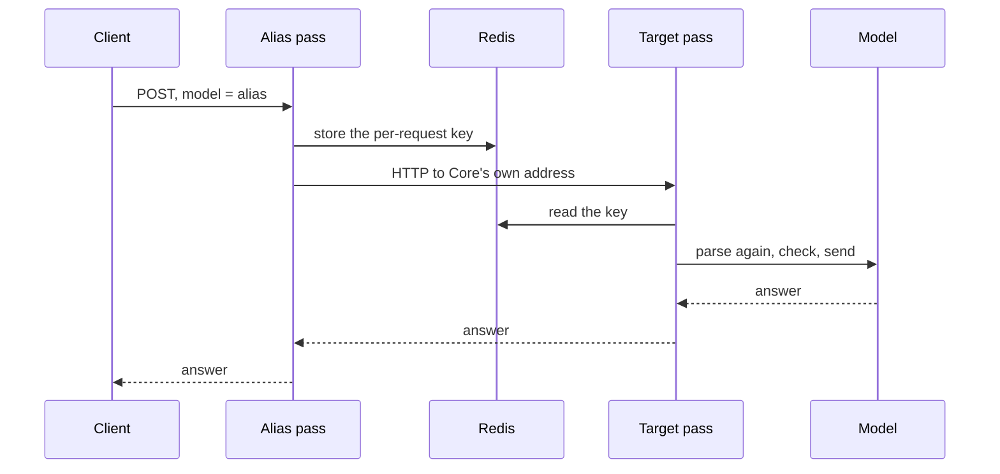
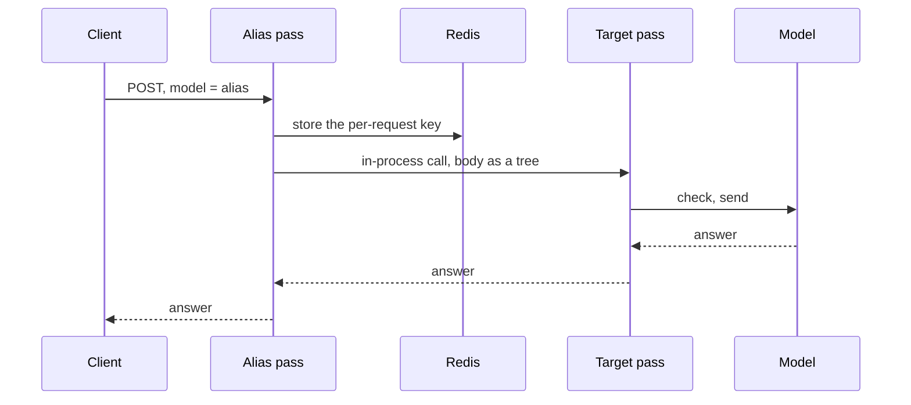

# Design

## Context

A call to an alias runs as two passes through Core. The alias pass resolves the alias, then sends the request to
Core's own address over HTTP, with a path that names the target. The target pass arrives as a new HTTP request: it
reads the alias pass's per-request key from Redis, parses the body again, and does the checks, limits, charging and
retries of the target. Each pass writes its own analytics row, and both rows carry the bodies.

The plugin work added a second way to start a pass: an origin plugin calls a deployment in process. Core then runs a
child pass with no HTTP request, no key lookup and no body bytes, and hands the parsed body over as a tree. A child
pass writes a row without bodies and writes nothing on the current span, because both belong to the plugin. This
change sends the alias hop the same way.

Today:



After:



## Decisions

### D1. The hop is an embedded origin with a built-in forward plugin, not a new kind of request

`ProxyClient` returns an `EmbeddedProxyRequest` whose plugin is a constant in Core:

```java
(request, host) -> host.call(new Call(request.uri(), request.headers(), request.bodyTree()))
```

The URI is already the target's, so the plugin only hands it on. Client watching, cancelling, host registration and
answer conversion are the ones a plugin call uses. Unlike a configured plugin, this one skips the platform rule: it
is Core's own code, and a stored alias is not a platform application.

- **Rejected: a new `ProxyRequest` class that calls `VertxHostDelegate` directly** - it would repeat what
  `EmbeddedProxyRequest` does, with no difference in behaviour.
- **Rejected: a `plugins` entry of type `forward` and a `dial-plugin://` base url on the alias pass** - the `forward`
  provider is a sample left out of the default image, stored aliases are refused as plugin origins, and Core's own
  behaviour would depend on admin config.
- **Rejected: one pass, with no alias pass** - a rewrite of the alias feature and its spec; out of scope.

### D2. One check decides both the transport and the body handling

A pass goes in process when all three hold: the deployment is an alias pass, the pass is not a background job, and
the request path is one of the in-process create routes (Messages `count_tokens` is not). The same check drives the
send and the body (D3). If the two disagreed, an HTTP send would carry the caller's bytes with `model` still set to
the alias, and Core would resolve the alias again and call itself in a loop with no depth limit.

Everything else an alias sends stays on HTTP: features, MCP, stored-response operations, background Responses and
`count_tokens`.

- **Rejected: a new url scheme (`dial-core://`) in the alias pass's interfaces** - background Responses and
  `count_tokens` would need the HTTP base url back, so the pass would carry two sets of urls.

### D3. In process, the body goes over as a tree and is not serialized

The alias pass keeps the tree on the context, as a pass does for a plugin interface. The alias row has no bodies
(D4), so nothing else reads the bytes. A pass that has no bytes at all (it is itself a child pass) sets an empty
buffer, so that `Content-Length` has a value. An alias pass that sends over HTTP serializes as today.

When the target is a decision router, the router pass serializes the tree once, as a stand-in for the client's
bytes. A decision fallback restores the pass's bytes from the original request body, as today.

- **Rejected: serializing as today** - one full serialize per hop for bytes nobody reads.

### D4. Whether a row carries bodies depends on the deployment, not on the transport

The row of an alias pass has no bodies and no assembled response. Every other row has them, in process or not. So
the target row of an alias call keeps its bodies whatever the transport, and so does the row of a pass an origin
plugin calls in process.

Cost for plugin calls: the child row now carries the bodies too (log writer copies, and heap until they are
written). The embedded-call A/B was measured without them.

- **Rejected: keep the plugin child-pass rule and exempt the alias target pass** - two rules for one question, one
  keyed on the transport and one on the deployment, and a marker to tell them apart.
- **Rejected: no bodies in the alias target row either** - that row has the model, its usage and its cost; it would
  lose prompt and completion for every aliased call.
- **Rejected: bodies in the alias row, as today** - the tier chain logs the same bodies three times, and the log
  writer holds them on the heap until they are written.

### D5. The host marks the passes it serves for an alias hop; the mark is not derived from the key record

The two child-pass rules about spans stay for an origin plugin's call: its child pass must not write over the
plugin's span. The host an alias hop creates marks its child passes as alias target passes, and those two rules skip
a marked pass (D6). The two rules about missing bytes apply to both kinds, since a target pass has no bytes either.

- **Rejected: deriving the mark from the key record's `lentDeployment`** - the record of a lent application's pass
  carries it too, so a plugin's call under such a pass would be taken for an alias target.

### D6. The target pass writes on the alias pass's span and has no span of its own

The target pass runs with the alias pass's OTel context. Its request, operation and usage attributes and its
log-line enrichment go on the current span, the alias pass's server span, and replace the alias's values there. The
alias pass writes after the target has answered, so its latency, upstream attempts, Responses id and later log-line
keys stay.

When the alias pass is itself an origin plugin's call, the current span is the plugin's and the target pass writes
nothing on it (`VertxHostDelegate.writesOnAliasSpan`: the alias pass has a server span of its own, or is itself a
marked target pass, as an alias candidate of a router behind an alias is). The target's row and token-stats span
get a span id of their own with the alias pass's span as parent; that id has no OTel span.

- **Rejected: the plugin child-pass rule (no attributes)** - the model's `gen_ai.*` attributes and usage would be on
  no span for any aliased call.
- **Rejected: an OTel span per target pass** - more code, and not needed to keep the attributes; a later change if
  per-pass spans are wanted.

### D7. The target pass uses the alias pass's key record, not a copy

The record holds the lend and the execution path that the HTTP target pass read from Redis. Because it is shared, a
file grant the target pass makes lands on the record the alias pass checks, and the alias pass shares the file on
with its own caller. The alias pass still stores the key and deletes it at the end, because the attachment
collector updates the stored key and fails when it is missing.

- **Rejected: a copy of the record for the child pass** - it would keep today's narrower result through an alias and
  add a copy per call.

### D8. A failed hop ends through the alias pass's connect-failure path, also when the client has left

Ending and cancelling are the plugin path's: the alias pass's end and a decision fallback close the host, which
cancels an open target pass, and a reset discards the answer and cancels the call. One thing differs. When the
client has left and the hop fails, the pass goes to the alias pass's connect-failure path. That path tries no other
candidate for a closed client, and its finalize writes the router row, ends the span and deletes the key.

- **Rejected: the plugin attempt's branch for a client that has left** - it ends the pass with no finalize, so a
  router behind the hop would write no row; over HTTP the row was written.

## Differences from today

| What | Today (HTTP hop) | After (in process) | Requirement |
|---|---|---|---|
| Bodies in the alias row | present | none | analytics-log "Rows without bodies for an alias pass" |
| Bodies in the row of a plugin's in-process call | none | present, so a plugin's call logs them in two rows | analytics-log "Bodies in the analytics row"; "Rows without bodies for an in-process child pass" removed |
| Call the target refuses before its origin (limit, access, interface) | bodies in the alias row | no bodies logged: the target writes no row, as on a direct call | analytics-log "Rows without bodies for an alias pass" |
| `X-DIAL-OVERRIDE-NAME` at the target's origin | the target's name, unless the target sets its own | not sent, as on a direct call | deployment-aliases "Headers of an in-process alias call" |
| `Access-Control-Allow-Origin`, `X-DIAL-TRACE-ID`, `X-DIAL-SPAN-ID` on the answer | twice | once | deployment-aliases "Headers of an in-process alias call" |
| File the target's answer attaches | the alias's caller cannot read it | shared on with the alias's caller, as on a direct call | deployment-aliases "Attachments shared on through an alias" |
| Decide request of a decision router behind an alias | the client's bytes | the tree, serialized once | router-deployment "Decide request of an in-process call" |
| Server span of the target pass | its own | none; its attributes are on the alias pass's span (D6) | none; `docs/tracing.md` |
| Client gone before the answer | the target pass runs until the alias first writes to the client | the target pass is cancelled at once | none; `docs/dynamic-settings/aliases.md` |
| Call depth limit (32) | does not apply | applies; an alias chain cannot reach it (at most alias, router, alias) | none |

## Effect per request

Per alias call on a create operation:

| | Over HTTP (today) | In process |
|---|---|---|
| Core passes | 2 | 2 |
| HTTP requests into Core | 2 | 1 |
| Serializes | alias pass 1; target pass 1 for its origin | target pass 1 for its origin (a decision router: 1 stand-in) |
| Body copies over the wire | alias pass writes, target pass reads | none |
| Parses | caller's bytes 1, target pass 1 | caller's bytes 1 |
| Redis | alias key SET and DEL, target key GET, spans and limits of both passes | the same minus the GET |
| Blob operations | unchanged | unchanged |
| Rows with bodies | 2 | 1 (the target's) |

The tier chain (alias, decision router, alias, model) saves two HTTP requests into Core, two Redis GETs, two parses,
one serialize and two rows' bodies.

Expected, not measured: the embedded-call review estimated a child pass at about 11 to 17 ms less Core CPU than the
HTTP pass it replaced, at 383 KB. That run's child row had no bodies; here the target row keeps them and the alias
row drops them. Task 4.1 measures it.

## Risks / Trade-offs

- [The target pass reaches controller code no plugin call has used, and an `EmbeddedServerRequest` member that throws
  is hit] → D2 sends only the create routes in process; the existing alias, router and decision API tests now run
  the target pass in process.
- [Analytics consumers read bodies from alias rows] → stated as a behaviour change in the proposal and in
  `docs/dynamic-settings/aliases.md`; the target row has them.
- [Plugin calls log their bodies twice] → as an HTTP application's call to a model does; stated in
  `docs/dynamic-settings/plugins.md`. The log writer's heap cap (`analytics.maxPendingBodyHeapPercent`) still bounds
  the backlog.
- [Traces lose one server span per alias hop; the target row's `span_id` matches no OTel span] → documented in
  `docs/tracing.md`, as for plugin calls.
- [No idle timeout on the hop: over HTTP the client's idle timeout bounded it] → the target pass's own origin
  timeouts still apply, as for plugin calls.
- [The hop no longer moves to another event loop] → with several HTTP server instances the loopback connection could
  land the target pass on another loop; in process it runs on the alias pass's loop. No difference with the default
  single instance.
- [The handed-over tree is shared] → `EmbeddedProxyRequest.send` clears the context's tree when it hands it over.

## Migration Plan

None. No config or settings change. `backgroundJob.localBaseUrl` is still used by background polling and by the alias
requests that stay on HTTP. Analytics consumers that read bodies from alias rows read the target's row instead; rows
of plugin calls carry bodies from this version on. Rollback is a revert.

## Code map

On `development` (f61fff688).

The alias pass:

- `AliasPasses.java:build` builds an `AliasApplicationPass` (an `AliasToolSetPass` for a toolset alias) and the MCP
  endpoint; `AliasPasses.java:overridePaths` and `AliasPasses.java:passFeatures` point the interfaces and feature
  endpoints at Core's own address.
- The address is `backgroundJob.localBaseUrl`: `AiDial.java:start`, `AliasService.java:setLocalBaseUrl`.
- `DeploymentService.java:getInterceptors`: an alias pass has no interceptors.

How a pass sends (D1, D2):

- `BaseDeploymentPostController.java:createProxyRequest(InterfaceType)` is the one place that builds the request. Its
  callers: `BaseChatCompletionController.java:processChatCompletionsRequestBody`,
  `MessagesBaseController.java:sendRequest` (also `MessagesCountTokensController`),
  `ResponsesController.java:sendRequest`.
- `DeploymentEndpointUtil.java:findRequestPathMapping` resolves the URI (`count_tokens` keeps its own path).
- `ProxyClient.java:http` and `ProxyClient.java:embedded` (the platform rule D1 skips).
- `ResponsesController.java:proceedToDeployment` sets `ProxyContext.isBackgroundJob` before the send.
- `EnhanceDeploymentRequestFn` sets the body's `model` from the pass's `overrideName`.
- HTTP clients that stay: `DeploymentFeatureController`, `McpProxyController`, `ResponseItemController`.

The body (D3):

- `BaseDeploymentPostController.java:setProcessedRequestBody` serializes or keeps the tree. Messages and Responses
  always pass `changed = true` (`MessagesBaseController.java:prepareUpstreamRoute`,
  `ResponsesController.java:handleRequestBody`).
- `BaseDeploymentPostController.java:sendProxyRequest` sets `Content-Length` from the pass's bytes.

The in-process call machinery to reuse (D1, D8):

- `EmbeddedProxyRequest.java:send` hands the tree over, creates the host, registers it
  (`ProxyContext.java:addHostDelegate`), watches the client (`EmbeddedProxyRequest.java:onClientGone`) and converts
  the answer (`EmbeddedProxyResponse`).
- `VertxHostDelegate.java:call` serves a call as a child pass: `CREATE_ROUTES` only, `MAX_CALL_DEPTH`, an
  `EmbeddedServerRequest` (its `DROPPED_HEADERS`, `Content-Type: application/json`) and `EmbeddedServerResponse`, a
  `ProxyContext` from the parent's key record, `child.setCallTree`, then `Proxy.java:dispatch`.
- `ProxyContext.java:closeHostDelegates`, called from `finalizeRequest` and
  `RouterDecisionFlow.java:retryWithNextCandidate`.

The six readers of `ProxyContext.java:isChildPass` (D4, D5):

- Missing bytes, kept for both kinds: `DeploymentPostController.java:readRequestBody`,
  `RouterDecisionFlow.java:inProcessCall`.
- Bodies, rekeyed on the alias pass: `AnalyticsLogContext.java:from`,
  `BaseChatCompletionController.java:completeProxyResponse`.
- Span, skipped for a marked pass: `GenAiTraceAttributes.java:set`,
  `AutoEnrichedOtelJsonLayout.java:buildEnrichedOtelLogRecord`.

The HTTP target pass this replaces, and the key (D7):

- `Proxy.java:handle` and `Proxy.java:handleRequest` (server span, CORS and trace response headers),
  `ApiKeyStore.java:getApiKeyData`, `ApiKeyData.java:initFromContext` (the lend and the execution path).
- `CollectResponseAttachmentsFn.java:apply` and `processAttachedFile`; `ApiKeyStore.java:updatePerRequestApiKey`
  throws when the stored key is missing.
- `ProxyUtil.java:setOverrideNameHeader` and `copyHeaders` (the `X-DIAL-OVERRIDE-NAME` difference).
- `RouterDecisionFlow.java:handleResponseError` wrote the router row over HTTP (D8).
