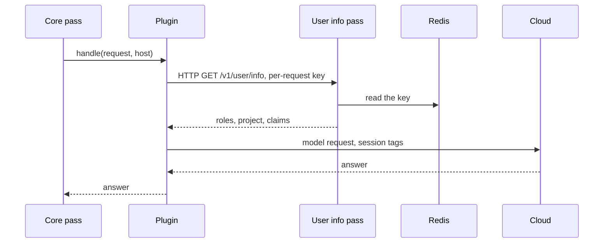
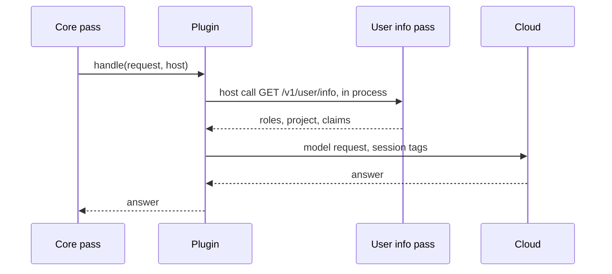

# Design

## Context

An origin plugin answers a request inside Core and gets a host for that request. Through the host it can call a
create operation of a deployment: Core serves the call as a child pass, an in-memory request that Core's own controller
selection routes, authenticated by the per-request key record the plugin's pass already holds, so there is no HTTP
request into Core and no key lookup. Everything else a plugin needs from Core goes over HTTP to Core's address, with
the per-request key in `API-KEY`. The model-provider plugin needs one such thing on every request that resolves
`UserInfo.<path>` session tags: `GET /v1/user/info`, whose roles, project and claims it puts into the tags. Over HTTP
that read is a server span, a Redis lookup of the key and a pass through the user info controller. Core tells a child
pass apart by the body tree it carries, and a pass without one is taken for a pass with a server span of its own.

Today:

After:

## Decisions

### D1. A GET goes through the same `call`, and `Call` gains a method

The plugin builds `new Call(HttpMethod.GET, "/v1/user/info", headers, null)` and gets a `Response` as for any call:
the status, the headers, then the body as a stream. The answer, the cancel, the end with the request and the `401`
after it are the ones a `POST` call has, with no second path to keep in step. The method comes first, as in `Request`.
The three-argument constructor stays and means `POST`, so plugin jars built against today's API run, and their
sources compile, unchanged.

- **Rejected: the user info in `Caller` (claims and display name added), so no call is needed** - the plugin's tags
  are paths into the `/v1/user/info` answer, whose shape `Caller` does not have: `Caller.project` is the JWT's project
  claim for a JWT caller, while the answer has no `project` for one. The plugin would rebuild the user info
  controller and drift from it, and every plugin request would carry claims few plugins read.
- **Rejected: `HostDelegate.userInfo()` returning the answer as a tree** - a separate contract per route a plugin
  needs later; the issue asks for methods other than `POST`.
- **Rejected: a second record or interface method for a `GET`** - two ways to make a call that differ only in the
  method.

### D2. The host serves every route of Core's API

A call reaches the controller Core's controller selection picks for its method and path, as that request sent over
HTTP with the call's key does: the user info, resources and files, sharing, limits, the configured routes, the create
operations. Each controller checks the key's access, so a plugin reaches nothing it could not reach over HTTP with
that key, and a path Core does not serve gets the answer it gets over HTTP. The in-process answer already streams with
backpressure, reset and cancel, which a file download's pipe needs. What `Proxy.handleRequest` answers before it
authenticates a request (`OPTIONS`, a method outside its list, `/health`, `/version`, `/openapi.yaml`, MCP resource
metadata) a call does not reach: it goes to controller selection, as a path Core does not serve. None of it needs a
key, and a plugin has no use for it.

The alias hop asks the host whether a path is a create route (`takesBodyTree`, formerly `servesCall`), to decide
whether an alias pass goes in process. That question keeps its meaning: create routes only. The host of an alias hop
keeps serving the create routes only: it serves a request Core builds to an alias's target, and a toolset alias's
chat completion names the toolset's MCP endpoint, which must fail as a chat completion to the toolset does
(deployment-aliases "Toolset alias over an MCP application").

- **Rejected: `GET` on the user info route besides `POST` on the create routes** (the first design of this change) -
  a list to grow with each consumer, which the review of this change asked to drop: the key, not the list, bounds
  what a call reaches. What the list did protect, a write losing its body, D4 covers.
- **Rejected: `GET` on every route, `POST` on the create routes only** - the same list for writes, which need only the
  body as bytes (D4).

### D3. A pass is a child pass when its request is the in-memory one, not when it has a body tree

A `GET` call has no tree, so with today's test its pass would count as one with a server span of its own:
`Proxy.dispatch` writes the pass's conversation id and parent span on the current span, which is the plugin's server
span, and the log layout enriches that span with the user info pass's log fields. Only the host creates the in-memory
request, one for each pass it serves (a call, or an alias's target pass), so every pass that counts as a child today
still does, and a `GET` pass does too, with no step the host has to remember. The decision router's in-process call
checks for the tree itself, as today, and so does the router pass's empty-body read
(`DeploymentPostController.readRequestBody`), which checked for a child pass: the tree is what it reads.

- **Rejected: an empty tree for a `GET`** - those two readers would take it for a body.
- **Rejected: a flag the host sets on each pass it starts** - a field and a step to keep in step with the request
  the host creates, which already marks the pass.

### D4. The body goes to a create operation as a tree, and to any other route as bytes

A create operation's pass takes the call's body as a tree, as before. Every other controller reads
`request.body()`, which was always empty in process: a `PUT` of a conversation through the host would have written an
empty conversation and answered `200`. The in-memory request now serves the body's bytes, serialized on a worker.
The host reads them before the pass starts, on the pass's own context, and answers a body longer than
`resources.maxSize` `413` `Request body is too large`, as `Proxy.handleRequest` does before any controller over HTTP:
most controllers outside `ResourceController` do not measure the body themselves (the PR review). It drops a
`Content-Length` the plugin passes on from its own request, which `ResourceController` would check against its
limit; the body is whole, and the host measures it. A call may carry a body or not with any method, as over HTTP: a
`GET` ignores it, and a `POST` outside the create operations without one is answered as an empty body is over HTTP.
A call to a create operation without a body fails, as before this change. A call without a method or a uri fails.

A call cannot carry a multipart body or open a WebSocket. The host fails a call whose `Content-Type` is multipart or
whose `Upgrade` names a WebSocket, before any controller reaches the members of an upload or a WebSocket, which still
throw; a plugin sends those to Core over HTTP.

- **Rejected: a `GET` with a body refused** (the first design) - one more rule than HTTP has.
- **Rejected: the bytes for every call, create operations included** - a serialization per model call that the create
  operations never read. A create operation's tree is not measured: no call of one was before this change.
- **Rejected: the size check where a controller first reads the bytes** - each controller turns a failed read into
  an answer of its own (`AdminApplyController` answers `400`), so the `413` would differ by route.
- **Rejected: a route list for the upload and WebSocket routes** - the list D2 dropped; the headers are what select
  the upload and WebSocket handling.

### D5. Every call keeps the key, the depth limit and the end with the request

The call carries the key a `POST` call carries: the plugin's pass key, or the decide request's key on a decide
request, so the answer describes the client's caller, as the HTTP read with that key does. The depth check runs for
every call, so a `GET` from a plugin 32 deployments deep gets `400`, as that plugin's `POST` calls do. After the
request has ended, and while answering a notice, the call gets `401`.

The checks keep today's order. The call's own fields come first (a method, a uri, and a create operation's body) and
fail the call even after the request has ended. Then a closed host answers `401`. Then come the background rule, an
upload or a WebSocket, and the depth. The body's size is checked last, once its bytes are serialized, just before
the pass starts.

- **Rejected: no depth check for a `GET`** - an extra branch for a plugin whose other calls fail at that depth
  anyway; a `GET` of user info starts no further pass, so it cannot loop.

## Differences from today

| What | Today | After | Requirement |
|---|---|---|---|
| A call outside the create operations through the host (`GET /v1/user/info`, a resource's `PUT`, `GET`, `DELETE`) | the call fails | served in process with the call's key; a body as bytes, `413` over `resources.maxSize`; an upload or a WebSocket still fails | deployment-origin "Core's API through the host", "Calling a deployment from an origin plugin" |
| The same calls while deciding | the call fails | served with the decide request's key; a notice gets `401` | router-deployment "Calls of an embedded router while it decides" |
| Server span of such a call, when the plugin uses the host instead of HTTP | a server span of its own | none; the call writes nothing on the plugin's span (D3) | none; `docs/tracing.md` |
| `Call` in the plugin API | path, headers, body; always `POST` | method first; the three-argument constructor means `POST` | none (plugin API) |

Calls over HTTP keep working unchanged.

## Effect per request

Per plugin request that reads the user info through the host instead of over HTTP:

| | Over HTTP (today) | Through the host |
|---|---|---|
| HTTP requests into Core | 1 | 0 |
| Redis | 1 GET of the per-request key | none |
| OTel server spans | 1 | 0 |
| Core passes | 1 (user info: no limits, no row) | 1, in process |
| Encode and parse of the answer | Core encodes, the plugin parses | the same |
| Analytics rows, blob operations | none | none |

Any other call outside the create operations saves the same when it moves to the host, plus the serialization of a
body moving from the plugin to Core's worker. Create operations' calls: none, they lose a route check and serialize
nothing new. Expected, not measured: the saving needs the plugin side, which comes after this change; task 4.1
measures it then.

## Risks / Trade-offs

- [Controllers outside the create operations run on the in-memory request for the first time] → it serves every
  member they read but those of an upload, a WebSocket, cookies and the connection, which a call cannot carry; one
  that throws ends in a `500` for the plugin, as an error of the controller does. Tests cover the user info for both
  caller kinds and the decide key, and a resource written, read and deleted. Paths Core answers before it
  authenticates (`/health`, `/version`, the OpenAPI document) are not routes of the controller selection, and a call
  gets what an unknown path gets.
- [A plugin keeps the host past its request and reads the user info later] → `401`, as for any call after the end,
  and as the HTTP read gets once the key is deleted.
- [The plugin API record changes] → the kept constructor and accessors keep jars built against the old API working;
  a plugin that deconstructs `Call` with a record pattern stops compiling, which is unlikely for a record a plugin
  builds and hands over.
- [Traces lose the user info read's server span] → `docs/tracing.md` says that calls from an origin plugin have no
  server span of their own; a user info call is one of them.

## Migration Plan

None. No config or settings change. Plugins keep reading the user info over HTTP until they move to the host call;
a plugin that uses a `GET` call needs a Core with this change, as it needs the matching plugin API version. Rollback
is a revert.

## Code map

On `development` (4a2aecb0d).

Plugin API (`aidial-core-plugin-api`):

- `Call.java`: the record and its javadoc, which lists the create operations.
- `HostDelegate.java:call`: the javadoc says Core checks, limits, charges and logs a call, lists the failures, and
  says `GET /v1/user/info` and file reads go to Core over HTTP.
- `Request.java`: the method comes first there.
- Three-argument callers that stay unchanged: `ProxyClient.java:FORWARD` (the alias hop),
  `ForwardOriginPluginProvider.java` (the `forward` sample), the tests.

The host and the in-process request (D1, D2, D4, D5):

- `VertxHostDelegate.java:call`: the argument check (path and body), the closed host's `401`, `servesCall` against
  `CREATE_ROUTES`, the background check (`isResponses`), the depth check (`MAX_CALL_DEPTH`), the
  `EmbeddedServerRequest` and `EmbeddedServerResponse`, the child `ProxyContext` from `callKey` or
  `ProxyContext.java:getProxyApiKeyData`, `setCallTree`, `setAliasTargetPass`, then `Proxy.java:dispatch`.
- `VertxHostDelegate.java:servesCall` is also read by `BaseDeploymentPostController.java:isInProcessAliasHop`; it keeps
  meaning the create routes (D2).
- `VertxHostDelegate.java:forRouter`: the decide request's key, and a host closed from the start for a notice.
- `EmbeddedServerRequest.java`: the class javadoc (a `POST`; members no create controller uses throw), `method()`
  answers `POST`, and the constructor sets `Content-Type: application/json` and drops `DROPPED_HEADERS`.
- `EmbeddedServerResponse.java`: the answer side, unchanged.

The user info pass:

- `Proxy.java:dispatch`: `GenAiTraceAttributes.initialize`, `ContextManager.setProxyContext`, then
  `ControllerSelector.select` by method and path.
- `ControllerSelector.java`: `get(RouteTemplate.USER_INFO, ...)`; `RouteTemplate.USER_INFO`.
- `UserInfoController.java:handle`: roles, then `project` for a key caller or `userId` and `userClaims` for a JWT
  caller, then `userDisplayName`.
- `ProxyContext.java:<init>`: for a per-request key, the claims and the original key come from the key record.

The child-pass mark (D3):

- `ProxyContext.java:isChildPass` (`callTree != null` today), `getRequest`, `setCallTree`, `getCallTree`,
  `isAliasTargetPass`. `VertxHostDelegate.java:call` is the only place that creates an `EmbeddedServerRequest` and
  calls `setCallTree`.
- Readers: `GenAiTraceAttributes.java:set`, `AutoEnrichedOtelJsonLayout.java:buildEnrichedOtelLogRecord`,
  `VertxHostDelegate.java:writesOnAliasSpan`, `DeploymentPostController.java:readRequestBody` (no tree check),
  `RouterDecisionFlow.java:inProcessCall` (checks the tree).

Tests to extend:

- `EmbeddedCallApiTest` (`testCallOutsideTheCreateOperations`, `testCallAfterThePluginsPassEnded`,
  `testCallerWithApiKey`, `testCallerWithJwt` show the patterns), `EmbeddedDecisionApiTest`; `UserInfoApiTest` has
  the HTTP answers the scenarios pin.
- Tests that mark a child pass by `setCallTree` alone or assume a `POST`: `ProxyContextTest`
  (`testCallTreeUntilTheBodyIsSet`), `GenAiTraceAttributesTest` (`childContext`), `EmbeddedServerRequestTest`.
- `config/TestOriginPluginProvider.java`: `X-Test-Call`, `X-Test-Decide-Call`, `X-Test-Notice-Call`, and `HOSTS` for a
  call after the pass.

Docs: `docs/dynamic-settings/plugins.md` ("Calling another deployment"; "Translating for a deployment",
"Responses"; "Deciding for a router", "The key"; "The forward sample"), `docs/dynamic-settings/routers.md` (the
plugin paragraph of "Decision mode"), `docs/tracing.md` ("Calls from an origin plugin").
