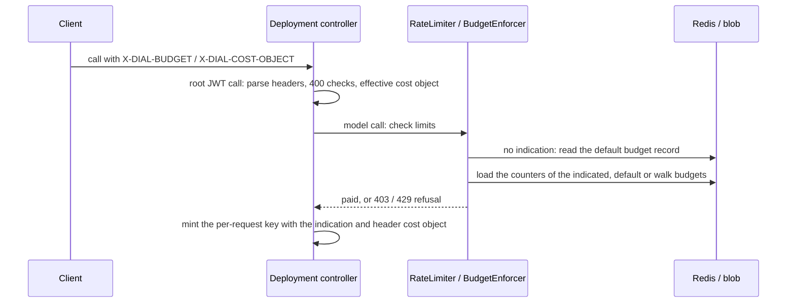

# Design

## Context

Today a JWT caller's call to a model is checked against budgets in `RateLimiter.checkLimits`, after the controller
has resolved the deployment. `BudgetEnforcer` takes the caller's cost object (the token's claim, else
`defaultCostObject`), lists the budgets of that cost object that match the caller and cover the call's coverage
chain, and walks them in priority order: the first with money left pays. Calls made with a per-request key carry
the root's claims in `ApiKeyData`, so they resolve the same cost object. Nothing in the request can name a budget,
and the user's default budget, stored since #2364, is only read and written through `/v1/user/budgets/default`.
After the change, a JWT caller's root call first has its budget headers checked, on any deployment, and the
budget check then follows the ladder: indication, default, walk.

## Decisions

### D1. The 400 checks run on the root call to any deployment, before the limit check and before the key is minted
The headers belong to the root request and are stored in the per-request key, so they are checked where the key
is made: once, on the root JWT call, whatever the deployment is (model, application, router, translated
deployment). A bad header to an application then fails at once, and the key only ever stores a checked value. The
checks run in every mode, as they need no budget counter.
**Rejected: check at each model call** - an application's call would get the user's 400, and an application that
calls no model would carry a bad header unnoticed.
**Rejected: check in `RateLimiter.checkLimits`** - deployments-POST does not limit-check applications, and a
translated deployment is not checked at all, so the root of those calls would skip the check.

### D2. The key stores the indication and a header cost object only when the root has them
`ApiKeyData` gets `budgetIndication` and `headerCostObject`, written with `@JsonInclude(NON_NULL)`. Without them,
the next hop computes the effective cost object from the stored claims exactly as the root did (claim, else
`defaultCostObject`). `ApiKeyStore` reads keys with a mapper that fails on unknown fields, so a key carrying a field
an older pod does not know is refused by that pod during a rolling upgrade: this way only keys of root calls that
sent a budget header are affected.
**Rejected: always store the cost object and its source** - every per-request key would carry new fields, and an
older pod would refuse every application's call during the rollout.
**Rejected: re-read the headers on each hop** - the hop's headers come from the application, which must not move
the user's spend.

### D3. Whether the provider sets `costObjectPath` is read from `ExtractedClaims` at the root and not stored
The identity provider adds a `costObjectPathSet` component to `ExtractedClaims`, excluded from JSON. Only the root
needs it: it decides whether `X-DIAL-COST-OBJECT` and the indication's cost object count, and whether
`cost_object_mismatch` applies. The hop then reads the result from D2.
**Rejected: serialize it with the claims** - the claims are stored in every per-request key, with the rollout
problem of D2.

### D4. The default budget is read on each model call that reaches the default step
`DefaultBudgetService.findDefault` runs on the task executor in the budget check when the call has no indication,
in `shadow` and `enforce`. The record is a resource that `ResourceService` caches in Redis, its absence included, so
the read is one Redis GET, with a blob read when the cache entry has expired. A default changed mid-session applies
from the next model call, as a standing preference should.
**Rejected: read once at the root and store it in the key** - another stored field (D2), and a read for every root
call to an application even when it never calls a model.
**Rejected: an in-memory cache per pod** - a `PUT` on one pod would not reach the others until it expired.

### D5. A declared payer goes through the walk's counter load as a one-element candidate list
The indicated budget and the default budget, once checked for holding and coverage, are passed to
`BudgetEnforcer.pickPayer` as a list of one. The exhausted result, its `retry-after` and the reported cap then come
from the same code as the walk's.
**Rejected: a separate path for declared payers** - it would repeat the exhausted result and the cap building, and
the two would drift.

### D6. Under a header cost object, `TRUE` rules are dropped from the subject before matching
"Held" under source `header` means a non-`TRUE` rule of the subject matches the caller. A subject
`[TRUE, sub = alice]` still holds for alice through her rule, and for nobody else.
**Rejected: skip budgets whose subject has only `TRUE` rules** - a subject with a `TRUE` rule and a `sub` rule
would still match dave through the `TRUE` rule.

### D7. Holding is checked separately from coverage
An indicated budget is held when it is a cost budget instance of its cost object, unexpired, whose subject matches
the caller (D6 applying). Only then is coverage checked, through the same chain match the walk uses
(`BudgetInstance.covered().indexOfFirstCovered`, or `isAll`). This gives `no_budget` and `budget_not_applicable`
their own causes, and the `no_budget` message is the same for a budget that does not exist, belongs to another
subject or has expired. Chain attribution (the earliest position) does not apply to a declared payer: it covers or
it does not.
**Rejected: run the walk's `EffectiveBudgets.resolve` and look for the indicated id** - it filters by coverage
first, so a held budget that does not cover the call would read as not held.

### D8. The not-applicable messages name the head of the coverage chain
`budget_not_applicable` and `default_budget_not_applicable` name the deployment the call came in through (the tier
alias the user typed), not the model behind it: a budget is written over the names a user sees, and the M2 design
keeps the models behind budgets out of every answer.
**Rejected: name the model** - for a tier alias it shows a model the user never asked for.

### D9. The 400s answer with the DIAL error body on every route
The root check throws an `HttpException` built from a `RateLimitResult` that carries the `SpendingRefusal`, through
the existing rejection path, so `error.code` is written as for the other refusals. A client that sends DIAL headers
speaks DIAL, and one body shape is simpler to test.
**Rejected: the Anthropic and Codex error bodies on their routes** - those clients do not send these headers, and
the bodies have no place for the code.

## Differences from today

| What | Today | After | Requirement |
|---|---|---|---|
| Which budget pays | the priority walk over the cost object | the indication, else the default budget, else the walk (if allowed) | budget-resolution: Indicated budget is the payer; Default budget pays an unindicated call; Walk behind autoBudgetSelection |
| Malformed `X-DIAL-BUDGET` / `X-DIAL-COST-OBJECT` on a JWT root call | ignored | 400 in every mode | budget-resolution: Malformed budget headers refused |
| Cost object without a claim path | claim, else `defaultCostObject` | `X-DIAL-COST-OBJECT` or the indication's cost object can set it, with source `header` | budget-resolution: Cost-object header without a claim path; Indication without a claim path |
| `TRUE`-only budget under a header cost object | n/a | not held | budget-resolution: Header cost object does not attest |
| Spend headers on Messages and Responses | only with exactly one budget in the cost object | the payer of the call | spend-limit-reporting: The payer is reported |
| `analytics cost_object.source` | `claim`, `key`, `default` | also `header` | analytics-log: Cost object in the analytics row |
| `dial_budget_rejections_total` reasons | `no_budget`, `budget_exhausted` | also the 400 codes, `budget_not_applicable`, `default_budget_not_applicable` | spending-refusals: Refusals metered by code |

## Effect per request

| Call | Today | After | Measured by |
|---|---|---|---|
| JWT root call to any deployment | - | parse two headers, no I/O | none needed |
| Model call, `shadow`/`enforce`, no indication | candidates' counter loads | one more resource read (one Redis GET; a blob read when the cache entry expired), then the same loads, or one load when the default pays | `resource.get` spans per call in an integration test (tasks 6.2) |
| Model call with an indication | candidates' counter loads | one counter load | the same test |
| Messages/Responses model call, `enforce` | one extra in-memory listing of the cost object's budgets to decide whether to report | none | - |
| `off` mode | - | header parse only; no read | - |

## Risks / Trade-offs

- [Rolling upgrade] An older pod refuses a per-request key that carries `budgetIndication` or `headerCostObject` →
  only root calls that sent a budget header are affected, for the length of the rollout (D2). Release notes say
  so.
- [Breaking 400s] A client that already sends a malformed `X-DIAL-BUDGET` gets 400 where it was ignored → the
  headers are new to DIAL, so no known client sends them; release notes call out the 400s and 403s.
- [Default read cost] Every unindicated model call of a JWT caller pays a Redis GET for the default → measured in
  task 6.2; the record's absence is cached too.
- [Router fallback] A 403 for a router's candidate lets the router try its next candidate, as `no_budget` does
  today → an indicated budget that covers one candidate and not another pays for the one it covers.

## Migration Plan

None for data: the new flags default to the M1 behaviour (`autoBudgetSelection: true`, `budgetMandatory: false`),
budget counters keep their paths, and a caller with no default and no header is paid by the same budget as in M1.
Deploy as usual; release notes list the new headers, the 400s and the reporting change.

## Code map

- Root header check and effective cost object: `DeploymentPostController.handleDeployment` and the unified routes
  through `BaseDeploymentPostController` (`ChatCompletionsController`, `ResponsesController`,
  `MessagesBaseController`); rejection path `DeploymentPostController.handleRateLimitHit`, `RateLimitResult`.
- Header element rule: `PolicyService.isValidElement` (to share, with `ConfigPostProcessor.ENTITY_NAME_PATTERN`).
- Refusal codes: `SpendingRefusal` (all codes exist).
- Effective cost object: `CostObject.resolve`, `CostObject.Source.HEADER`; `ProxyContext.resolveCostObject`,
  `ProxyContext.getCostObject`, `ProxyContext.getCostObjectSource`, the `ProxyContext` constructor that reads
  `extractedClaims.project()`.
- Claim path flag: `IdentityProvider.toExtractedClaims`, `IdentityProvider.getCostObjectPath`, `ExtractedClaims`.
- Key data: `ApiKeyData.initFromContext`, `ApiKeyData.pathOf`; key reads `ApiKeyStore` (via
  `ProxyUtil.convertToObject`).
- Ladder: `BudgetEnforcer.checkBudgets`, `BudgetEnforcer.pickPayer`, `BudgetEnforcer.next`,
  `BudgetEnforcer.rejectNoBudget`, `BudgetEnforcer.buildExhaustedResult`, `BudgetEnforcer.reject`,
  `BudgetEnforcer.resolveCandidates`, `BudgetEnforcer.resolveCoverageChain`, `BudgetEnforcer.startCheck`,
  `BudgetEnforcer.toSpendCaps`, `BudgetEnforcer.hasLimitedWindow`.
- Holding and the attestation rule: `EffectiveBudgets.resolve`, `EffectiveBudgets.isSubjectMatched`,
  `EffectiveBudgets.toRule`, `EffectiveBudgets.isExpired`, `CostObjectIndex.getInstances`, `BudgetInstance.covered`.
- Default budget: `DefaultBudgetService.findDefault`, `DefaultBudgetService.findHeld`; wired in
  `AiDial` and `Proxy.getDefaultBudgetService`, to pass into `RateLimiter` / `BudgetEnforcer`.
- Limit flow: `RateLimiter.checkLimits`, `RateLimiter.checkBudgetsWithSpendCaps`, `RateLimiter.readSpendCaps`
  (keeps the one-budget rule).
- Analytics: `BudgetCheck.noBudget`, `BudgetCheck.exhausted`, `AnalyticsLogContext`, `GfLogStore`.
- Flags: `SpendingLimits`.
- Tests to extend: `BudgetSpendCapsApiTest`, `BudgetChainCoverageApiTest`, `BudgetAnalyticsLogApiTest`,
  `CostObjectAnalyticsLogApiTest`, `DefaultBudgetApiTest`, `MessagesSpendLimitApiTest`, `ResponsesSpendLimitApiTest`,
  `ApiKeyDataTest`, `SpendingLimitsConfigTest`, and under `limiter/budget` `BudgetEnforcerTest`, `EffectiveBudgetsTest`,
  `CostObjectTest`; configs under `server/src/test/resources/dial-config/` (`budget-spend-caps.json`,
  `budget-chain-coverage.json`, `user-budgets.json`).
