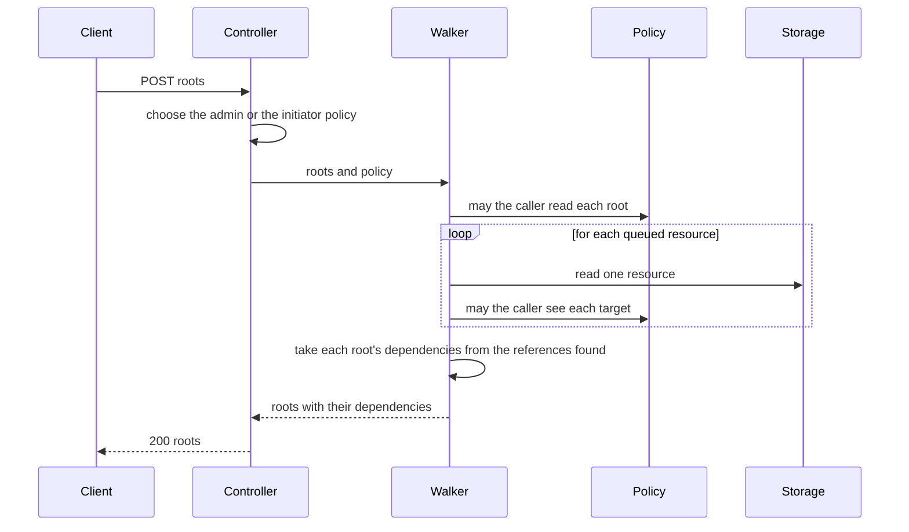

# Design

## Context

An Application names the resources it needs by short name, by URL and under `dial:` markers in its properties, and Core has no call that lists them. This change adds one read-only call that returns, for each selected Application, the flat list of the resources it reaches. The graph is explored once, breadth first, for all roots: each resource is read once, and only its identity and what it refers to are kept, never its body. Each root's list is then taken from those references. The check of what a caller may see lives in a policy, not in the walk. An explicit admin walks `public/`, `platform/` and the file configuration. Any other caller walks what they may read, and the deployments their roles allow, and an element they may not see is left out. The walk reads a few records and streams nothing, so it takes no bucket lock.



## Decisions

### D1. The answer is one flat list of dependencies per root, in one fixed shape
Each root carries the flat list of everything it reaches, so a client reads "what does this Application need" from one entry, with no flag to interpret and no graph to join. The request holds `roots` and nothing else, and the answer mirrors it: `roots`, in the same order, each entry holding the identity of the root and its `dependencies`. An item of `dependencies` has the same four identity fields as a root entry, so a `url` taken from any element is a valid root of a later request. A resource that is a root and is also needed by another root is an entry of its own and an item in the other root's list. `dependencies` is always present, an empty list when the root references nothing. The answer has no flag, no count, no warning and no reference between resources, so memory does not grow with the number of references.

Request:

```json
{
  "roots": [
    { "type": "application", "url": "applications/public/team/support-bot__1.0" },
    { "type": "application", "url": "applications/platform/summarizer" }
  ]
}
```

Answer:

```json
{
  "roots": [
    {
      "type": "application", "url": "applications/public/team/support-bot__1.0", "name": "support-bot__1.0", "origin": "public",
      "dependencies": [
        { "type": "application",             "url": "applications/platform/summarizer",       "name": "summarizer",  "origin": "platform" },
        { "type": "application-type-schema", "url": "schemas/platform/quick-app",             "name": "quick-app",   "origin": "platform" },
        { "type": "interceptor",             "url": null,                                     "name": "pii-filter",  "origin": "file" },
        { "type": "file",                    "url": "files/public/team/support-bot/icon.png", "name": "icon.png",    "origin": "public" },
        { "type": "model",                   "url": "models/platform/gpt-4o",                 "name": "gpt-4o",      "origin": "platform" },
        { "type": "model",                   "url": null,                                     "name": "gpt-4o-mini", "origin": "file" }
      ]
    },
    {
      "type": "application", "url": "applications/platform/summarizer", "name": "summarizer", "origin": "platform",
      "dependencies": [
        { "type": "interceptor", "url": null,                     "name": "pii-filter",  "origin": "file" },
        { "type": "model",       "url": "models/platform/gpt-4o", "name": "gpt-4o",      "origin": "platform" },
        { "type": "model",       "url": null,                     "name": "gpt-4o-mini", "origin": "file" }
      ]
    }
  ]
}
```

| Field | Where | Value |
|---|---|---|
| `type` | root entry and item | `application`, `model`, `interceptor`, `application-type-schema`, `catalog-schema`, `file`, `skill`, `prompt` |
| `url` | root entry and item | The resource URL (a user-bucket URL keeps its encrypted bucket); `null` for an entity of the file configuration and for a configuration deployment shown to a user (D7) |
| `name` | root entry and item | The last segment of the path; the name of the deployment for an entity of the file configuration; the digest of its `$id` for a schema of the file configuration |
| `origin` | root entry and item | `public`, `platform`, `file`, or `private` for a user bucket |
| `dependencies` | root entry only | The flat list of everything the root reaches, each once, breadth first, never the root itself |

In the example `summarizer` is a root and also a dependency of `support-bot`, and the resources the two roots share are in both lists.

### D2. One endpoint under `/v1/ops` for every caller
The path names the operation, not a use of it, so the same route serves a transfer between environments, a preview and any later consumer, and a later type of root needs no new path. The caller decides the policy: an explicit admin gets the admin policy, any other authenticated caller the initiator policy.

### D3. One walk, two access policies, each resource authorized on its own
The walk asks the policy two questions: may this root be used, and may these targets be read and listed (asked once for a whole level of the walk; a listed target is always walked). Selecting a root never authorizes its dependencies, because a reference can name a resource in another user's bucket. The admin policy checks the right to read in `public/`, accepts `platform/` and the file configuration through the admin gate, and does not check the roles of a deployment.

### D4. The initiator policy asks for the caller's own reach, never the combined permissions
It uses the right to read from the caller's own bucket, resources shared with the caller and the public folder rules (`lookupInitiatorPermissions`), asked once per level of the walk, and the roles of a deployment for the deployments of the configuration. The combined `lookupPermissions` adds admin standing, global-reader standing and the grants of a calling key, so a global reader would read every `platform/` descriptor and the stand-ins of the file configuration.

### D5. The initiator walks inside configuration deployments
A user's Application works because the platform applies the interceptors and the dependencies of the Models it calls, so the list shows what the Application uses at run time, not only what it declares. Every found element is checked on its own (READ for a URL, roles for a deployment), and the answer holds no references between resources, so a reader sees that an element is used, not which deployment pulled it in. This was chosen by the product owner.

**Cost accepted:** a user may learn that a platform Model carries a particular Interceptor. The rule lives only in the initiator policy and can be tightened without a change of the answer.

### D6. An element the caller may not see is left out without a trace
Not read, not checked for existence, no change of status, no marker in the answer: a marker or a warning would confirm that something exists, and one hidden dependency must not empty the answer. For a root, the right to read is checked before the lookup: a root the caller may not read is `403` whether or not it exists, and `404` only follows a confirmed right to read.

### D7. `url` is the resource URL the caller can send back; `null` where there is none
A user-bucket URL keeps its encrypted bucket, so a URL from the answer is a valid root and the decrypted location never leaves. An entity of the file configuration has no URL, and a deployment of the configuration that a user sees has no address the user can use, so both have `url` null. `origin` stays `platform` or `file` for them, because the storage layout of deployments the user can already call is not a secret.

### D8. No bucket lock; the configuration pair is read under the publication lock
The walk only reads records and returns, like a plain `GET` of a resource, so it takes no bucket lock: an admin write would otherwise wait for a read, and a held lock would turn a read into `409`. It reads the merged configuration and the skipped-entity records together under the lock that every configuration publication holds, and the file-sourced configuration after them. The lock is held for two reads (longer while a rebuild runs), because a rebuild between the reads could pair an entity with the wrong skipped-record set.

### D9. The graph is explored once for all roots, and each root's list is taken from what the resources refer to
The walk reads each resource once, however many roots reach it, and keeps for each examined resource its identity and the list of the resources it refers to that the policy allows, never the body. Memory holds only the queue of resources to examine, the set of resources met, those identities and references, and the answer built so far; a body is dropped as soon as its references are found, so memory does not depend on the size of any resource. Each root's list is then a breadth-first pass over those references, with no read. The root is in its own set of resources met from the start, so it never appears in its own list, in a cycle or through a reference to itself. The kept references are metadata of the same order as the answer, which holds each reachable resource once per root that reaches it. A finding about a shared resource is logged once, not once per root.

### D10. Reference discovery follows fixed rules; the spec requirements state each one
For an Application, a Model and an Interceptor Core reads `interceptors`, `dependencies`, `catalog_schema_id`, `icon_url` and the marked values of `catalog_properties`, and for an Application also `application_type_schema_id` and the marked values of `application_properties`. The markers are found by validating the properties against their schema with a recorder, so one bad value does not hide the others. A value is classified in a fixed order: blank, external URL (never fetched), unsafe path (never read), resource URL, short name, anything else malformed. A short name is resolved with its origin from three read-only signals (the merged configuration, the file-sourced configuration and the platform blob) and the skipped-entity records, because the merged configuration does not say where an entity came from; a name that no entity holds, that more than one type holds or whose signals disagree is not followed, and a valid platform blob wins over a file entity of the same name. A schema is found by the `$id` in its body, a remote application type schema is requested live with local `$ref` only, and a schema that cannot be read makes its references unreliable without failing the request. A reference that is not followed is one log record with the key of the referring resource, the JSON pointer and a reason, never the value.

## Differences from today

None: `development` has no call that lists dependencies, so no existing behaviour changes. The additions to existing classes are additive and request-time behaviour of those classes is unchanged.

## Effect per request

`development` has no such request. The cost of one call, and how it is measured:

| | After | Measured by |
|---|---|---|
| Storage round trips | one read per examined resource (the body is bound once and dropped after its references are found), one existence check per leaf, one scan per schema type per request | counting `ResourceService` in `DependencyWalkerTest` and in the API tests |
| Permission lookups | initiator policy: one batched `lookupInitiatorPermissions` per level of the walk, which reads the caller's shared-with-me record once per resource type; admin policy: the read check of `public/` targets | `DependencyWalkerTest` with a counting policy |
| Remote schema | one HTTP request per application type schema with an endpoint, and a non-admin can cause it by naming such an Application | `DependencyListRunnerFailureApiTest` |
| Locks | none; the publication lock for two reads | an API test with a concurrent admin write |

## Risks / Trade-offs

- **The platform wiring is visible to a user (D5)** → only elements the caller may see are listed, the answer holds no references between resources, and the policy is one class that can be tightened.
- **A short name resolves without roles** (`ShortNameResolver` ignores `user_roles`) → the initiator policy applies the roles after the name resolves; a test lists a Model the caller's roles do not admit.
- **A user can make Core call a runner** by naming an Application whose type schema has an endpoint → the endpoint comes from a stored type schema and never from the request, a schema is built once per request, and no limit on calls is added here; a rate limit or an outbound allow-list is a platform concern outside this change.
- **Memory and time grow with the reachable graph (D9)** → the kept references are identities and links, never bodies, and the answer holds each reachable resource once per root, so the answer is the larger of the two; the walk costs one read per examined resource, and no limit on the number of elements is added (out of scope in the proposal).
- **Not a snapshot** → a write during the walk may or may not be in the list; the answer is an overview, not a transfer set.
- **User-bucket Applications are not covered by today's bucket binding**, which allows them in `public/` and `platform/` only → the initiator policy needs its own rule for them, and the apply step confirms from the code that an Application in a user bucket is readable by URL before writing it.

## Migration Plan

None: the endpoint is new and `x-preview`, no setting is added, and nothing on `development` changes behaviour.

## Code map

Class names are in `server/src/main/java/com/epam/aidial/core/server`.

**New classes**
- `controller/DependencyListController`: the route handler; chooses the policy, answers `403` for a per-request key, decides every status before the body.
- `service/DependencyWalker`: the one exploration, the references of each examined resource, the list of each root.
- `service/DependencyRequestParser` (`DependencyRequestBody`, `DependencyRoot`, `DependencyRequest`): the body, parsed with the `EncryptionService`.
- `service/DependencyAccessPolicy`, `AdminAccessPolicy`, `InitiatorAccessPolicy`, `DependencyTypePolicy`: the two questions of D3 and the type rules.
- `service/DependencyEntityBinder`, `DependencyResource`, `DependencyRootEntry`, `DependencyListResponse`: the binding of a stored body to its entity, and the answer.
- Reference discovery: `DeploymentEdgeDiscovery`, `DiscoveredEdge`, `DiscoveryResult`, `ShortNameResolver`, `ShortNameResolution`, `SchemaReferenceResolver`, `FileConfigEntities`, `DependencyResourceNames`.
- Marker capture: `validation/MarkerRecorder`, `MarkerCollection`, `CollectionIssue`, `CollectionIssueKind`.

**Existing classes, changed additively**
- `service/ApplicationSchemaService.java:buildReferenceSchema`, `collectMarkerReferences` and a `quiet` schema download; `service/CatalogSchemaService.java:collectMarkerReferences`; the hooks in `validation/DialFileKeyword`, `DialResourceKeyKeyword` and `CatalogFileKeyword`.
- `data/RouteTemplate.java`, `controller/ControllerSelector.java`, and `openapi-generator` `AnnotationEndpointCollector.java:CONTROLLER_CLASSES`: the route and the OpenAPI entry.

**Existing classes, relied on unchanged**
- `security/AccessService.java:lookupInitiatorPermissions`; `security/ConfigAuthorizationService.java:isAdmin`; `config/Deployment` through `RoleBasedEntity:hasAccess`.
- `controller/AccessControlBaseController.java`: the access-before-existence status order; `service/ConsentService.java:buildConsent`: the precedent for a role- and READ-checked walk over `dependencies`.
- `util/ResourceDescriptorFactory.java:fromAnyUrl`; `storage` `ResourceService:getResource`, `hasResource`, `getResourceMetadata`; `service/resource/ComplexResourceService.java:getMarker`.
- `config/MergedConfigStore.java:get`, `getInvalidEntities`, `getFileSourcedConfig`; `security/ApiKeyStore.java:getMutationLock`.
- `controller/ResourceController.java:getApplicationData`: a caller with READ already sees `interceptors` and `dependencies` of a stored Application.
