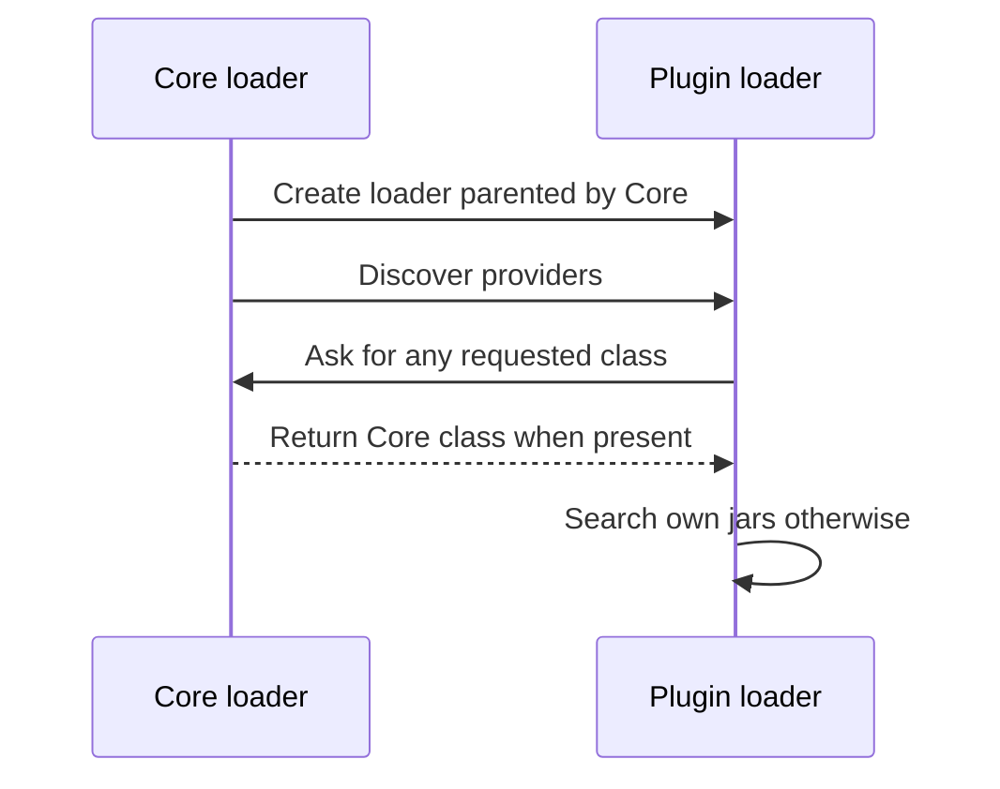
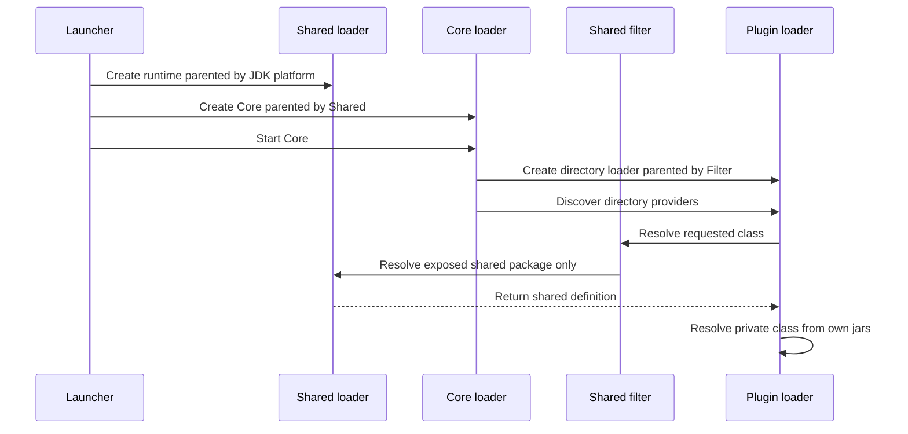

# Design

## Context

Core currently starts directly through the Gradle application script with its runtime jars on one application
classpath. It loads each enabled plugin directory through a separate parent-first loader whose parent is Core's
application loader. Plugin directories cannot see each other's jars, but every class on Core's classpath wins over
a plugin's bundled copy. The registry discovers providers once at startup, and plugin instances are created lazily,
validated on config writes/rebuilds, and closed outside the event loop. Shared Vert.x and Jackson types cross the
plugin API, while logging and tracing use Core-configured implementations. Core's Logback XML references a
Core-defined JSON layout, and its tracing setup installs a constructed SDK into the logging appender and Vert.x.
Plugin invocations currently have no explicit thread context class loader scope.

Today:



After:



## Decisions

The eight decisions below correspond to the eight questions settled during exploration. This is a draft design,
not an implementation-ready change: the remaining wiring details in Risks / Trade-offs must be resolved before
spec deltas and tasks are finalized.

### D1. Share explicit package trees, not Core's entire classpath

Shared defines the plugin API and libraries whose types or singleton state must be common. Filter exposes exactly
these package-tree prefixes; the trailing dot makes the package boundary explicit:

```text
com.epam.aidial.core.plugin.
io.vertx.core.
io.netty.
com.fasterxml.jackson.core.
com.fasterxml.jackson.databind.
com.fasterxml.jackson.annotation.
org.slf4j.
io.opentelemetry.api.
io.opentelemetry.context.
```

Core and plugins receive the same definitions for these classes. No broader `com.epam.aidial.core.`, `io.vertx.`,
`com.fasterxml.jackson.` or `io.opentelemetry.` delegation is implied. Shared also contains the runtime dependency
closure needed by its own classes, but those additional packages are not automatically plugin-visible; for example,
OpenTelemetry API/context 1.67.0 needs `opentelemetry-common` internally.

Shared's parent is the JDK platform loader. Core is a child of Shared. Each plugin directory has a separate loader
whose parent is a filtering view of Shared. Filter uses the platform loader as its actual parent and an explicit
reference to Shared; ordinary parent-first delegation directly to Shared would bypass the filter. Private plugin
classes resolve from that directory's jars, with no fallback to Core, Shared's hidden dependencies, or other
plugins. Shared classes resolve their own dependencies through Shared, never through Filter. Core can use Shared's
full runtime closure; plugin authors cannot rely on that closure outside the published package list.

The current model-provider plugin supports this starting boundary. Its SDKs/auth libraries, Reactor/Reactor-Netty,
Guava, Apache clients, Kotlin and Jackson extension modules remain private. Java implementations can extend shared
API classes or implement shared interfaces without exposing their implementation packages.

**Rejected: retain Core as the unrestricted parent** - dependency sharing remains a side effect of Core's build.
**Rejected: expose Shared's whole dependency closure** - plugins could again borrow unrelated versions accidentally.
**Rejected: child-first for every package** - duplicate Vert.x, Netty or Jackson types would break the API boundary.
**Rejected: JPMS layers now** - Core and its API dependencies remain on the classpath; the provider dependency graph
already demonstrated module-resolution failures under that layout.

### D2. Keep service descriptors private to each plugin directory

The plugin loader's `META-INF/services/*` lookup returns only descriptors from its own jars. Core discovers
`PluginProvider` explicitly through that directory loader, so the shared interface can have private provider
implementations. Plugin dependencies likewise discover their private Azure/AWS HTTP providers, Jackson extension
modules and Kotlin reflection implementations. Merge service descriptors within a plugin's fat jar as its build
requires, not across classloaders.

Shared's own discovery uses Shared and can read its own logging/telemetry descriptors. Core's existing classpath
provider discovery is separate from directory discovery and must not leak its descriptors into plugin lookup.
Both single-resource and resource-enumeration APIs need this boundary; filtering only class loading is insufficient.

Access to selected Shared services is an optional future feature. No Shared descriptor merging is part of the
initial design. Ordinary non-service resource filtering remains a draft implementation detail to settle before
apply; it must preserve private resources without leaking Core or other plugin resources.

**Rejected: inherit every parent service descriptor** - a private library can discover an unintended provider.
**Rejected: use the service interface's package to force descriptor ownership** - shared `PluginProvider` and Jackson
`Module` interfaces legitimately have plugin-private implementations.

### D3. Put logging and telemetry implementations in Shared, configured by Core

Shared contains the logging backend, OpenTelemetry SDK/autoconfigure/providers/exporters, their required runtime
libraries and the Vert.x OpenTelemetry context-storage provider. Filter still exposes only D1's APIs. Plugins log
and trace through those APIs; Core owns implementation configuration and shutdown.

Shared performs implementation discovery with its own defining or explicit loader. Core must establish the logging
configuration and telemetry/context-storage selection before plugin providers or instances run. The Vert.x storage
provider property must be set before first context-storage use, because that choice is cached.

Core's custom `AutoEnrichedOtelJsonLayout` stays Core-private. Core explicitly supplies its logging configuration and
objects to Shared-owned Logback; changing TCCL alone is not a substitute for this wiring. Preserve current JSON
attributes, log levels and telemetry-appender behaviour. The exact bootstrap/configuration API and the choice of
global SDK registration versus a shared API handoff remain draft details, not silently accepted decisions.

The inspected default SLF4J and OpenTelemetry discovery paths use defining or explicit loaders. Conditional Logstash
formatter startup can call Jackson's TCCL-based module discovery; it is not used by the current default XML. Control
that discovery explicitly if the supported logging configuration invokes it.

**Rejected: keep backends/SDKs Core-private and rely on parent lookup** - Shared cannot resolve classes in its child.
**Rejected: expose backend/SDK packages to plugins** - plugin access to shared APIs does not require implementation
class visibility.

### D4. Scope TCCL at Core-to-plugin calls and restore it on synchronous return

TCCL is the thread context class loader used by some libraries for resource/service discovery. Before Core invokes
plugin code, set it to the originating plugin directory's loader, then restore the previous value in `finally`,
including when the plugin throws. Nested calls restore the previous loader rather than assuming Core.

Cover provider static initialization/construction, type/validation calls, plugin creation, handling and closing,
response accessors/cancellation, and Core-invoked plugin stream methods or callbacks. Carry the originating loader
with the registry/provider/instance/response metadata; a shared stream implementation's defining loader is not
necessarily the plugin loader. Existing providers defined on Core's classpath retain their own Core origin.

Restore as soon as the synchronous call returns, not when a returned future completes: Vert.x event-loop threads
are shared by unrelated requests. Core preserves its existing event-loop/context and blocking-close rules.
Plugins preserve/reapply their loader in asynchronous callbacks or executor tasks that require TCCL-based discovery,
or configure dependencies with an explicit loader instead. This does not automatically wrap arbitrary library
schedulers or existing thread pools.

No startup bytecode inventory or runtime instrumentation is included. Large shaded jars would add startup work for
findings that do not establish actual misuse. The bundled provider jar is about 141 MiB with roughly 71,000 class
entries, so diagnostics would require a separate cost decision.

**Rejected: leave plugin work on Core's TCCL unconditionally** - discovery may miss private services or see Core's.
**Rejected: retain plugin TCCL until future completion** - it contaminates a reused thread between callbacks.
**Rejected: instrument every TCCL getter/setter** - costly diagnostics of legitimate usage do not ensure correct
asynchronous propagation.

### D5. Start sibling loaders through a minimal launcher and split runtime directories

The JVM application classpath contains only the launcher. Runtime packaging separates:

```text
/app/bootstrap/             minimal launcher
/app/shared/                shared APIs, implementations and required runtime dependencies
/app/core/                  Core code and private dependencies
/app/plugins/<group>/<plugin>/
```

The launcher creates Shared with the platform parent, creates Core with Shared as parent, establishes Core's startup
context, and invokes `AiDial` through Core. Core creates only the enabled plugin directory loaders using Filter.
Shared and Core exist even without plugins. Do not also put Core/runtime jars on the launcher application classpath;
that would permit duplicate definitions and invalidate the boundary.

Keep operator entrypoint behaviour and directory include/exclude semantics. Docker distribution, local `:server:run`
and subprocess integration launch paths need the same arrangement. Ordinary unit tests can use normal test
classpaths, but they do not prove isolation. The concrete launcher module/build configuration and dependency
partition manifest must be fixed before tasks are finalized.

**Rejected: keep the ordinary application classpath and add sibling loaders later** - Core is already defined by the
wrong loader, and runtime libraries can be duplicated.
**Rejected: enable the hierarchy only when plugins are installed** - two runtime arrangements would make releases
behave differently and double startup/integration coverage.

### D6. Ignore bundled shared classes with a bounded startup warning, never fallback

Inspect jar entry names in each enabled plugin directory for D1's shared package trees, including versioned class
entries. Ignore bundled copies and warn with the directory id, offending jars and representative packages/counts;
bound and deduplicate the output rather than logging tens of thousands of classes. Do not decompress or parse class
bytecode for this check. Excluded directories remain unopened.

Both the filter and plugin loader must enforce shared-only resolution. If Shared lacks a requested shared-package
class, propagate failure even if a plugin jar contains it; a plain `URLClassLoader` fallback after parent failure
would otherwise violate D1. This warning is diagnostic evidence, not proof that the plugin's compiled version is
compatible with Shared. Existing malformed-jar, duplicate-provider/type and missing-provider startup errors remain.

**Rejected: reject all plugins bundling shared classes** - ignored copies need not prevent a usable deployment.
**Rejected: ignore silently** - operators lose evidence for later version/linkage failures.
**Rejected: fall back when Shared lacks a class** - one shared family becomes split across loaders again.

### D7. Migrate without a compatibility mode and verify the actual provider plugin

This is a breaking change to a preview feature. Plugin authors compile against the shared contract and bundle all
other implementation dependencies. Core no longer supplies private dependencies accidentally. Shared-library
versions are still tied to the Core release; isolation does not let plugins override the shared contract.

Align model-provider packaging exclusions with the exact shared packages rather than broad dependency groups.
Keep Kotlin stdlib and reflection together in the plugin. Remove #2383's Core component-metadata rule and update its
runtime test/docs only after provider/translator paths succeed with the split runtime without that rule. Do not
remove libraries independently required by the chosen Shared runtime closure.

Required verification includes two plugin fixtures and Core using conflicting private versions; shared type identity;
Core/other-plugin resource invisibility; private service discovery; warning/no-fallback behaviour; real launcher
startup; existing logging/telemetry output; nested/exception/asynchronous TCCL cases; and provider requests,
translation, Kotlin reflection and relevant cloud-auth paths. Existing tests using Core-classpath provider fixtures
must be distinguished from directory fixtures whose implementation classes really live in plugin jars.

**Rejected: legacy fallback or a compatibility switch** - it preserves the accidental dependency contract and hides
missing plugin packaging.
**Rejected: remove the Kotlin workaround before isolated runtime verification** - it would reintroduce the known
first-request reflection failure during migration.

### D8. Document native-library limits and handle demonstrated conflicts individually

Shared Netty owns its native libraries where used. Plugin-private native libraries remain subject to JVM loading
rules and library-specific process state. The JVM can reject the same native library path loaded by different
classloaders; separately extracted copies are not a generic guarantee of independent native state.

Document this limit and exercise native paths actually used by the provider plugin in deployment environments.
Resolve demonstrated conflicts individually rather than promising that Java dependency isolation isolates native
libraries too.

**Rejected: generic native isolation or detection initially** - correctness depends on the library and extraction
mechanism; no general conflict fix has been demonstrated here.

## Differences from today

No spec delta is authored in this draft. D references below are design requirements, not invented spec headers;
`plugin-registry`'s existing "Plugin directories loaded apart" requirement is the planned delta home.

| What | Today | After | Requirement |
| --- | --- | --- | --- |
| Plugin/Core sharing | Every Core-classpath class wins | Only published shared packages visible to plugins | D1; plugin-registry delta pending |
| Shared internal dependencies | Accidentally plugin-visible through Core | Hidden by Filter; plugin supplies its own private copy | D1 |
| Plugin service lookup | Inherits parent descriptors | Directory-private descriptors only | D2 |
| Logging/telemetry placement | Core application classpath | Shared implementation runtime; Core-configured | D3 |
| Core-to-plugin TCCL | No explicit scope | Originating plugin loader, restored on return | D4 |
| Launch/classpath | Direct AiDial application classpath | Minimal launcher plus separate Shared/Core loaders | D5 |
| Bundled shared definitions | Parent wins silently; missing parent class can load locally | Warning; strict shared-only resolution | D6 |
| Kotlin reflection | Core carries workaround alongside stdlib | Plugin owns its family; workaround removed after verification | D7 |
| Private dependency migration | Plugin may borrow Core versions | Plugin bundles everything outside shared list | D7 |

Directory layout, include/exclude behaviour, instance lifecycle, request routing, cancellation, charging and stored
records are intended to remain unchanged. Native limitations remain; D8 makes them explicit rather than claiming a
new runtime guarantee.

## Effect per request

| Work | Today | After | Verification |
| --- | --- | --- | --- |
| Core passes / HTTP origin calls | Existing plugin/in-process flow | Unchanged | Provider and Core integration fixtures |
| Forwarded-body copies/parses | Existing body/tree/retry handling | Unchanged | Same fixtures and code comparison |
| Redis/blob round trips | Existing request/config operations | Unchanged | No new storage call in loader/TCCL code |
| TCCL scope per Core-to-plugin boundary | None explicit | Read previous loader, set plugin loader, restore in finally | Nested/exception tests; measure representative streaming workload |
| Class resolution | Existing parent-first lookup | Filtered lookup during loading/linking | Isolation tests; no throughput claim without measurement |

Startup adds a launcher, runtime partitioning and shared-class entry inspection; it does not add a full bytecode
scan. Private library copies can increase metaspace and heap/static-state use. Measure real startup and a
representative provider request/stream before claiming negligible overhead; no startup or per-request timing was
measured during exploration.

## Risks / Trade-offs

- **Shared closure is larger than the exposed package list.** Build a reproducible dependency partition and verify
  Shared can resolve every required runtime dependency without Core. Merely putting the API jars in Shared is not
  enough; closure-only packages must remain hidden from plugin delegation.
- **Core-defined logging layout cannot be found by Shared's ordinary XML loading.** Core must explicitly supply
  objects/configuration. Confirm the exact bootstrap path, early static logger ordering and custom configuration
  compatibility before apply; the current XML cannot be assumed to work unchanged.
- **Telemetry can initialize the wrong context storage or expose a no-op global instance.** Select the Vert.x provider
  before first use and decide global registration versus an API handoff before apply. The current Core SDK builder
  does not by itself establish plugin use of that SDK through `GlobalOpenTelemetry`.
- **Ordinary resources and build partition are not fully specified yet.** Finish non-service `getResource`/
  `getResources` ownership, JDK resource handling, launcher build wiring and the dependency manifest before the
  change is marked ready for implementation. These are draft follow-ups, not permission to widen the shared list.
- **Plugin asynchronous work can lose TCCL.** Document author responsibility and test actual dependency paths.
  Core wrappers cannot repair arbitrary schedulers, cached discovery or inherited worker-thread state.
- **Shared libraries can use TCCL for optional discovery.** Default paths were inspected, but custom Logstash/Jackson
  module discovery needs an explicit loader/module policy when invoked. Plugin-private descriptors are not widened
  as a workaround.
- **Shared API types impose one version.** Bundled-class warnings aid diagnosis but do not certify binary
  compatibility. Keep API/version alignment and test real SDK/auth paths.
- **Native collisions and extra memory remain.** Apply D8 and measure realistic deployments; do not treat loaders as
  process isolation.
- **Evidence is bounded.** The provider jar built and three existing isolation tests passed after excluding unrelated
  Python HTTP-case generation. Those tests expose broader Vert.x/OpenTelemetry prefixes and do not run the sibling
  hierarchy. A separate throwaway harness passed five fresh-JVM scenarios for shared logging, default/explicit SDK
  discovery, lazy Vert.x context storage, TCCL restoration and synthetic layout visibility. It did not boot Core,
  run the real plugin, export traces, exercise event-loop asynchronous propagation, or load unchanged Core XML.
  The synthetic layout probe used Logback's TCCL-based class-loading overload, not the actual XML instantiation
  path; it does not prove the proposed logging wiring. Turn these checks into repository integration coverage.

## Migration Plan

1. Finalize the draft wiring details above and author/review the `plugin-registry` delta and implementation tasks.
2. Build the launcher and split runtime with explicit Shared/Core packaging; preserve entrypoint/settings behaviour.
3. Rebuild provider and sample plugins for the target Core release. Coordinate the separate provider-repository PR
   so its exact packaging and asynchronous discovery responsibilities are verified before rollout.
4. Run split-loader integration and provider/translation/auth tests. Remove the Kotlin workaround only after those
   paths work without it; retain anything independently required by Shared's resolved dependency closure.
5. Roll out the Core image and matching plugin builds together. Existing directory mounts stay in place; changing
   libraries or the launcher runtime still requires a restart.
6. Roll back Core image and plugin artifacts together to the prior compatible pair. A plugin built under the new
   contract can contain private copies that the previous parent-first Core would override, so mixed-version rollback
   is not presumed safe. Configuration records and storage formats do not change.

## Code map

Existing Core sources on `development` (paths relative to repository root):

- `server/src/main/java/com/epam/aidial/core/server/plugin/PluginRegistry.java:load`, `listJars`, `addProviders`:
  directory loaders, provider discovery/initialization, retained origin loader and shared-entry warnings; keep the
  current directory/pattern/error checks. New loader/filter/scope helpers have no existing implementation.
- `server/src/main/java/com/epam/aidial/core/server/config/ConfigPostProcessor.java:validatePlugin`: provider
  validation scope, including write and rebuild paths; preserve current warning semantics/settings copy.
- `server/src/main/java/com/epam/aidial/core/server/plugin/PluginManager.java:create`, `createOutsideRequest`,
  `closePlugin`: carry originating loader through creation/close while preserving Vert.x dispatch and executor use.
- `server/src/main/java/com/epam/aidial/core/server/proxy/embedded/EmbeddedProxyRequest.java:send`, `onAnswer`,
  `toProxyResponse`: handler scope and origin metadata on delayed response adaptation.
- `server/src/main/java/com/epam/aidial/core/server/proxy/embedded/EmbeddedProxyResponse.java:EmbeddedProxyResponse`,
  `statusCode`, `headers`, `getHeader`, `body`, `discard`, `exceptionHandler`, `handler`, `pause`, `resume`, `fetch`,
  `endHandler`: response/stream invocation boundaries and cancellation.
- `server/src/main/java/com/epam/aidial/core/server/AiDial.java:main`, `start`, `setupTracing`, `setupMetrics`:
  launcher handoff, initialization order, SDK/appender/Vert.x configuration; preserve Core-owned metrics registries.
- `server/src/main/java/com/epam/aidial/core/server/log/layout/AutoEnrichedOtelJsonLayout.java:AutoEnrichedOtelJsonLayout`,
  `doLayout`: Core-created layout objects supplied to Shared Logback; do not move its Core dependencies into Shared.
- `server/src/main/resources/logback.xml`: default appenders/layout/levels to preserve through explicit wiring.
- `aidial-core-plugin-api/src/main/java/com/epam/aidial/core/plugin/PluginProvider.java:create`, `validate`,
  `Plugin.java:handle`, `Response.java:body`, `cancel`, `HostDelegate.java:call`: contract types and author guidance.
- `aidial-core-plugin-api/build.gradle`: shared contract publication and dependency declarations.
- `build.gradle`: Kotlin metadata workaround and dependency constraints; `settings.gradle`, `server/build.gradle`:
  new bootstrap/build partition and distribution/local launch wiring.
- `Dockerfile`, `docker-entrypoint.sh`: split runtime distribution, preserved executable/user/certificate behaviour
  and existing sample-plugin destination.
- `server/src/test/java/com/epam/aidial/core/server/plugin/PluginRegistryTest.java`, `PluginManagerTest.java`,
  `KotlinRuntimeTest.java`, and `server/src/test/java/com/epam/aidial/core/server/proxy/embedded/EmbeddedProxyRequestTest.java`:
  extend existing fixtures; use actual directory implementation classes for isolation tests.
- `docs/dynamic-settings/plugins.md`, `CLAUDE.md`: shared contract, TCCL/native rules, migration and launcher guidance.

Provider repository references (relative to `ai-dial-model-provider-plugin`):

- `plugin/build.gradle`: `pluginJar` exclusions and merged service descriptors; separate coordinated PR.
- `plugin/src/main/java/com/epam/aidial/provider/plugin/ModelProviderPluginProvider.java:create`,
  `TranslatorPluginProvider.java:create`, `ModelProviderPlugin.java:handle`: actual contract crossings.
- `provider/src/main/java/com/epam/aidial/provider/core/Buffers.java`: shared Vert.x/Netty linkage.
- `provider/src/main/java/com/epam/aidial/provider/translation/AnthropicJson.java`, `ResponsesJson.java`: private SDK
  mappers and Kotlin-reflection paths.
- `plugin/src/test/java/com/epam/aidial/provider/plugin/PluginJarIsolationTest.java`: narrow the current broad filter
  and add real split-runtime/provider verification; its three existing tests are supporting evidence, not sufficient
  acceptance coverage.
