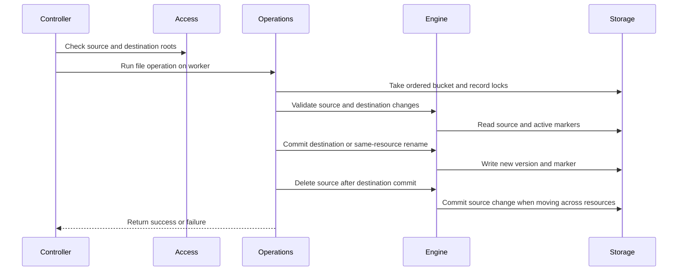

# Design

## Context

Plain files use v1 controllers and per-file conditional requests.
Complex file PUT and DELETE take the owning resource's aggregate ETag, while their v2 GET already returns the file ETag and ignores conditional headers.
Complex writes copy the current version under its marker lock, validate the mutation and commit by replacing the marker.
The marker holds file sizes and ETags, but full file metadata comes from storage.
Complex uploads already buffer one part for the byte-array mutation API; downloads stream.
Resource copy/move currently classifies complex URLs as whole resources and uses bucket locks before resource locks.
Plain-file moves also carry or revoke shares, whereas complex files inherit shares from their root.
The new file-operation path follows this flow:

## Decisions

### D1. Classify complex file URLs only in the new file paths

Add a shared resolver used by the new controllers and the extended ops branch. It returns either an ordinary file descriptor
or a complex root, normalized relative path and logical file descriptor. Split at the first files segment after the bucket;
reuse segment decoding and descriptor validation. Authorize the root before the v1-only hidden-path check and marker read.
Allow empty/trailing-slash relative targets to reach folder rejection or metadata listing. Hide reserved segments anywhere
in the complex path, including encoded forms, without tightening existing v2 routes.

**Rejected: Change fromAnyUrl globally** - sharing, publication and subscription callers rely on whole-resource descriptors.
**Rejected: Walk ancestors for a marker** - the delimiter already supplies the root and stored links must keep their meaning.

### D2. Add a v1 controller contract instead of changing the existing v2 controller

Reuse root authorization, multipart validation, metadata query parsing and worker execution patterns. Add the smallest
controller set needed for content and metadata, with branch-covering unit tests and one new UniversalFileApiTest HTTP suite.
The new content controller returns explicit multipart MIME type and file metadata on PUT, supports file conditions on GET,
and returns only X-Resource-ETag after DELETE. Match plain download transport, including its lack of partial Range support.
Expose both ETag headers through ProxyContext. Metadata has no new conditional-header handling.

Buffer the upload once, as the existing complex engine requires, with a bound enforced while receiving even for chunked
requests. Reuse that buffer at the engine boundary; do not introduce a second full-file buffering layer.

**Rejected: Implement old routes using the new controller** - existing bodies, conditions, MIME inference and statuses differ.
**Rejected: Build a new streaming mutation engine here** - it would enlarge the storage contract beyond this feature.

### D3. Check file conditions and capture response metadata inside the mutation transaction

Keep existing aggregate-conditional putFile/deleteFile entry points. Add scoped file-conditional engine entry points and
small result records carrying file metadata plus the committed aggregate ETag. Conditions run on the current file map
under the marker lock; use existing EtagHeader semantics and the legacy-marker map fallback. Capture storage-returned
FileMetadata before unlocking, then project its descriptor fields onto the logical URL, so concurrent writes cannot make
the response body and headers refer to different versions. Downloads capture one marker and use it for both the stream
and aggregate header.

**Rejected: Check a file ETag before calling aggregate putFile** - a concurrent mutation can invalidate that check.
**Rejected: Read the current marker again to build the response** - it can describe another writer's commit.
**Rejected: Accept either aggregate or file ETag** - this makes a conditional request ambiguous.

### D4. Reuse versioned storage and add owning-resource metadata without new records

Add an optional NON_NULL owning-resource reference to FileMetadata. Read full file metadata from the mapped current-version
blob; the marker alone cannot supply content type, author or timestamps. For folders, reuse ResourceService pagination and
recursion, project all descriptors onto the requested logical files folder, and enrich file nodes with their resource
reference. Compute permissions at the root once and assign them to the result and all nested nodes, not through per-file
permission lookups. Keep the existing v2 listFiles shape untouched.

**Rejected: Synthesize all file metadata from the marker** - it stores only size and ETag.
**Rejected: Add metadata to every stored marker entry** - existing blob metadata suffices and no migration is needed.

### D5. Commit same-resource copy or rename in one copy-on-write transaction

Add an engine file copy/move primitive. Under one marker lock, check source, overwrite, destination PUT validation and,
for move, source DELETE validation before copying. Validate changed entrypoint contents and refresh handler metadata.
Apply both paths to one fresh version, enforce limits against the final file set, preserve copied content/MIME/ETag,
then commit once and publish the existing logical events. A project may become empty; a skill may not lose SKILL.md.

**Rejected: Call putFile then deleteFile for a rename** - two commits expose an intermediate state and fail at final-set limits.
**Rejected: Copy raw blobs outside the engine** - this bypasses type validation, aggregate recomputation and logical events.

### D6. Preserve the lock hierarchy and commit cross-resource destinations first

Put the extended branch in a reusable file-operation coordinator beside the existing operation service. Acquire deduplicated
bucket locks first, then complex marker and ordinary file record locks in a fixed canonical-storage-key order within each
level. This refines unified_api.md's URL ordering to match the existing bucket-before-record hierarchy, including concurrent
legacy operations. Protect plain sources with their record lock, not just the bucket lock: ordinary uploads do not take
bucket locks. Add narrowly scoped already-locked storage/engine helpers rather than reacquiring non-reentrant locks.

After locking, re-read both sides, preflight source deletion and destination validation, then commit the destination and
remove the source. Use ResourceService copies for provider-side blob copy and cache invalidation; read bytes when an
entrypoint must be parsed. Propagate a failed source delete while retaining the committed destination. Source shares are
cleaned only after successful source deletion. Keep org-unit ownership checks on root descriptors.

The shared mutation commit boundary must distinguish pre-commit rollback from post-commit cleanup: copyOnWrite currently
catches an old-version cleanup failure after marker commit and can delete the new version. Correct that boundary where
reused by these operations so a committed marker never loses its referenced version. Do not extend this into an unrelated
storage or sweep refactor.

**Rejected: Sort bucket and marker locks together by logical URL** - this can invert the hierarchy used by existing requests.
**Rejected: Hold a bucket lock without the plain record lock** - a concurrent upload can be deleted by the move.
**Rejected: Delete the source first** - failed destination validation or storage would lose the only copy.

### D7. Scope new permissions and statuses to operations involving complex files

Branch only when at least one target is a complex file. Plain-to-plain and whole-to-whole operations keep their current
code paths, SHARE requirement on move, destination-conflict status and share relocation. In the new branch require
source READ for copy, source READ/WRITE for move and destination WRITE. Use 409 for overwrite=false destination conflicts,
400 for missing source, folders, equal canonical URLs or file/whole mixtures, and 404 for missing complex destinations.
The public-space move ownership restriction still applies, even across groups.

Complex root shares and publications never follow an individual file. Plain-to-complex moves revoke the deleted source's
shares/invitations and never manufacture a complex file grant; complex-to-plain destinations receive no copied grants.

**Rejected: Apply the new same-type exception or 409 to every operation** - successful legacy contracts must not change.
**Rejected: Move a complex file's root shares with it** - this would change access to all the other files of that resource.

## Differences from today

| What | Today | After | Requirement |
|---|---|---|---|
| Complex file URLs in v1 | No content/metadata route | Additive routes using the first files segment | Complex file routes use stored URLs |
| Multipart and PUT body | v2 infers MIME; returns empty body | v1 stores part MIME and returns file metadata | Complex file PUT uses multipart and returns metadata |
| Conditional writes | v2 uses aggregate ETag | New v1 writes use file ETag under lock | Complex file conditional requests use file ETags |
| Download ETag | v2 actually returns file ETag and ignores conditions, contrary to source design's summary | Leave v2 unchanged; v1 adds conditions and X-Resource-ETag | Existing file and resource APIs keep their behavior |
| DELETE response | v2 returns aggregate ETag | New v1 returns empty 200 and X-Resource-ETag, no aggregate ETag header | Complex file deletion preserves the resource contract |
| Metadata | v2 always lists a folder and omits full file fields | New v1 distinguishes item/folder, adds full metadata and root reference | Complex file metadata uses the v1 file shape |
| Folder URL and permissions | v2 lists under top-level files URL; no permissions parameter | v1 uses requested logical folder and root permissions | Complex metadata URLs keep the segment form; Permissions in metadata |
| Hidden paths | v2 rejects only leading reserved names, with 400 | New paths hide reserved segments at any depth, with 404 | New complex file APIs hide internal paths |
| File copy/move | Complex file URLs fail as whole-resource targets | File matrix across files/skills/projects; same-resource rename is one commit | Single-file operations extend resource copy and move |
| Move grants and overwrite conflict | Legacy move needs SHARE; existing destination may return 400 | Only new branch uses READ/WRITE and overwrite conflict 409 | Extended single-file operations use root permissions; Complex file operation overwrite conflicts are explicit |
| Cross-resource failure | No complex file move path; reused cleanup can erase a committed version | Destination-first file move, precommit-only rollback | Cross-resource moves never delete the only committed copy |
| Creation and org units | Whole-resource creation and existing ownership rules | No new creation path or ownership bypass | Complex file writes require an existing resource; Extended file moves preserve org-unit ownership |
| Mixed lock ordering | Bucket-before-record hierarchy | Preserve hierarchy, sort canonical keys within levels, no lock reentry | Cross-resource moves never delete the only committed copy |

## Effect per request

These are code-based expectations, not measured latency results. Counts depend on cache hits and file count.

| Request | Today | After | Measurement |
|---|---|---|---|
| Complex GET | One root marker read through ResourceService, mapped file stream; one controller/worker path; no body parse/copy | Same marker and stream path; file-condition check and aggregate header; no ancestor walk or extra body copy | Compare warm/cold v1/v2 HTTP latency and spy marker/blob calls |
| Complex PUT | One buffered multipart part and byte-array handoff; marker lock/read; current-version copy; file write; marker commit and events | Same mutation cost, explicit MIME and file precondition; return write-result metadata without re-reading current marker | Compare v1/v2 latency with identical file sets, MIME and sizes; inspect allocation boundary and storage calls |
| Complex metadata | Marker read, current-version folder listing | Item metadata read or existing listing with full file metadata; root permissions once rather than per-file access expansion | Count marker/blob metadata and permission lookups in service/controller tests |
| Same-resource file copy/move | Unsupported | One marker lock/read and one new version; provider-side file copy, final-set validation and one marker commit | Assert one commit/resource update and storage operation counts |
| Cross-resource file copy/move | Unsupported | Ordered locks; source read plus destination version copy/commit; move adds source delete commit | Failure/concurrency tests and spy storage/lock calls |
| Ordinary files and whole resources | Existing controllers and ops | Unchanged paths and storage work; optional DTO field omitted | Targeted plain/whole-resource regression tests |

No extra proxy pass or JSON parse of forwarded model traffic is involved. File-manifest validation retains its existing parse
cost; an entrypoint copied from another resource may need a content read before destination commit.

## Risks / Trade-offs

- Non-atomic cross-resource move can leave a duplicate → return an error, retain both copies, document overwrite=true retry.
- Marker/stream or metadata snapshots can drift → capture one marker per read and mutation-result metadata before unlocking.
- Mixed locks can deadlock or miss ordinary writes → retain bucket-before-record ordering and protect plain record locks; test reverse operations and concurrent replacement.
- Failed cleanup after commit can erase data → keep rollback before the marker commit boundary and test injected cleanup failure.
- Buffering chunked multipart can consume unbounded memory → enforce receiving limits, retain existing per-resource file limits and avoid a second buffer.
- Logical projection may expose internal URLs → test every metadata, error and event path, including nested/encoded reserved segments.
- Additional metadata reads for full listing fields may increase cold listing cost → reuse ResourceService metadata and bounded pagination; measure calls, do not claim marker-only synthesis.

## Migration Plan

No data migration. Existing markers and stored links remain valid. Deploy all pods before clients depend on the new paths
or extended file operations; older pods answer 404 or reject them. Rollback leaves the existing v1/v2 APIs usable, but clients
using the new paths must return to the existing APIs. No redirects, deprecation or sunset plan.

## Code map

Paths are under `server/src/main/java/com/epam/aidial/core/server/` unless a module is named.

- `data/RouteTemplate.java:COMPLEX_RESOURCE_FILE, COMPLEX_RESOURCE_FILE_METADATA, RESOURCE` - add separate v1 templates, including folder-shaped targets.
- `controller/ControllerSelector.java:complexResourceUrl` - reuse root extraction and register new controllers without changing v2 registrations.
- `util/ResourceDescriptorFactory.java:fromAnyUrl, fromUrl, fromEncoded` and `storage/src/main/java/com/epam/aidial/core/storage/util/UrlUtil.java:decodePath` - reuse descriptor/segment validation in the scoped file-target resolver; keep generic semantics unchanged.
- `controller/AccessControlBaseController.java:handle` - worker-thread root access before marker lookup.
- `controller/DownloadFileController.java:handle`, `controller/UploadFileController.java:handle, validateRequest`, `controller/FileMetadataController.java:handle, getContentType` - v1 transport, multipart, conditional and metadata references.
- `controller/ComplexResourceController.java:putFile, getFile, deleteFile, streamFile` and `controller/ComplexResourceMetadataController.java:handle` - unchanged v2 behavior, handler selection and upload/stream patterns.
- `util/ProxyUtil.java:etag, metadataQuery` - existing ETag and query parsing, preserving the plain limit error message.
- `Proxy.java:handleRequest` and `ProxyContext.java:exposeHeaders` - existing upload/body guard and CORS exposure; supplement receive-time bounds in the new controller.
- `service/resource/ComplexResourceService.java:getMarker, getFileStream, putFile, deleteFile, copyOnWrite, currentFileMetadata, commitMarker, aggregateEtag, publishEvents, normalizePath, versionFile, displayFileDescriptor, listFiles` - scoped per-file condition/result and copy/rename additions, existing snapshots/events and precommit rollback boundary.
- `service/resource/ComplexResourceHandler.java:validateFileMutation, refreshMetadataOnPut` and `service/resource/BaseFrontmatterHandler.java:validateFileMutation, refreshMetadataOnPut` - mutation and entrypoint validation; `ProjectHandler` permits empty projects.
- `data/folder/FolderResourceMarker.java:ResourceFileMetadata` - existing size/etag map, no new stored fields.
- `security/AccessService.java:lookupPermissions, populatePermissions` - lookup roots once; do not expand complex listing items into per-file checks.
- `controller/ResourceOperationController.java:copy, move, handleServiceError` - additive file branch, deduplicated roots, worker execution and existing error mapping.
- `service/ResourceOperationService.java:moveResource, moveResourceLocked, copyResource, hasResource` - preserve whole/plain behavior and keep file coordination separate from whole-resource share relocation.
- `service/OrgUnitService.java:requireSameUnit` - retain public move ownership checks on root descriptors.
- `storage/.../service/LockService.java:underBucketLocks, bucketKeys, lock` and `storage/.../service/ResourceService.java:lockResource, copyResource, deleteResource` - ordered lock hierarchy and scoped already-locked helpers with cache/event semantics.
- `storage/.../service/ResourceService.java:getResourceMetadata, getFolderMetadata, getResourceStream, putFile` - full current-version metadata, existing pagination/streaming and MIME-preserving writes.
- `storage/.../data/FileMetadata.java` and `MetadataBase.java` - optional owning-root reference and logical response projection; `storage/.../util/EtagHeader.java:fromHeader, validate` - existing conditions.
- `.github/workflows/pr.yml:generate_openai_spec` - generate the OpenAPI document through replaceSpec; do not hand-edit it.
